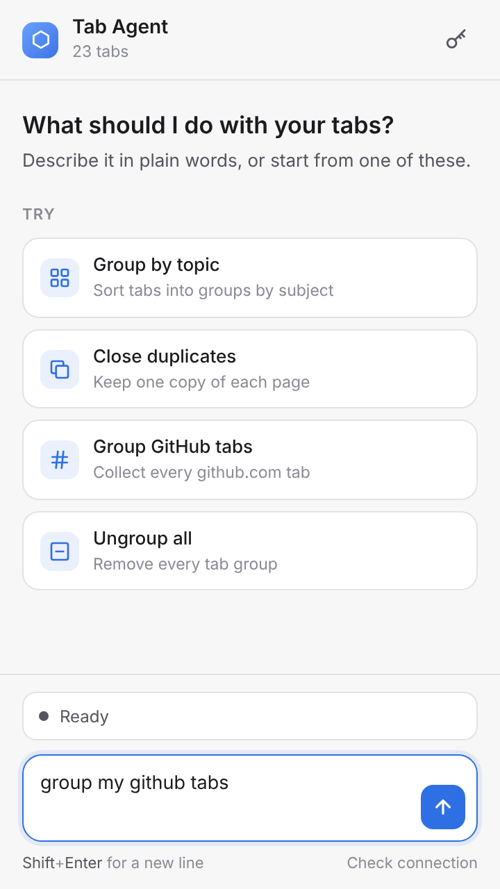
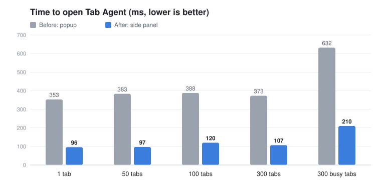

# 🗂️ Tab Agent

Organize your Chrome tabs by just saying what you want.

Type something like "group my GitHub tabs" or "close duplicates", and Tab Agent does it for you. Simple commands run instantly on your machine. Smarter ones, like grouping by topic, use Groq's free AI API.

<p align="center">
  
</p>

## ✨ What it can do

- Group tabs by site or by topic
- Close duplicate tabs
- Ungroup or close tabs in bulk
- Add tabs to groups you already have

## 🚀 Install

1. Get a free API key at [console.groq.com](https://console.groq.com)
2. Open `chrome://extensions` and turn on **Developer mode**
3. Click **Load unpacked** and choose the `chrome-manager-frontend` folder
4. Click the extension icon, then **API Key**, and paste your key

## 💬 Use it

Click the extension icon to open the side panel, type a command, and press Enter.

You can also use the address bar: type `tab`, a space, and your command, like `tab group github`.

Try:

```
group github
group by topic
close duplicates
ungroup all
```

## ⚡ Performance

Moving from a popup to a side panel made opening Tab Agent **3 to 4 times faster**, and it now opens faster than even a blank Chrome popup can.

<p align="center">
  
</p>

<sub>Measured with <code>npm run stress</code> on a MacBook.</sub>

## ⚙️ How it works

```
  You type a command
          │
          ▼
  Simple command? ── yes ──► matched locally, runs instantly
          │
          no
          ▼
  Service worker ──► Groq AI labels each tab with a topic
          │
          ▼
  Chrome tabs and groups are updated
```

- **Side panel and address bar** (`pop_up.html`, omnibox): where you type. Simple commands like `group github` or `close duplicates` are matched right there, with no network call.
- **Service worker** (`background.js`): handles commands that need judgement, like `group by topic`, and talks to Groq.
- **Groq**: only gives each tab a topic label. The extension itself decides the groups, so a wrong label can only misplace one tab.
- **Core logic** (`lib.js`): the matching and grouping rules, kept free of Chrome APIs so they are easy to test.

## 🛠️ For developers

See [docs/DESIGN.md](docs/DESIGN.md) for more detail.

## 📄 License

MIT
